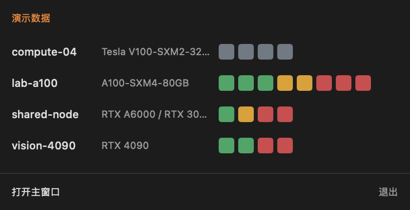
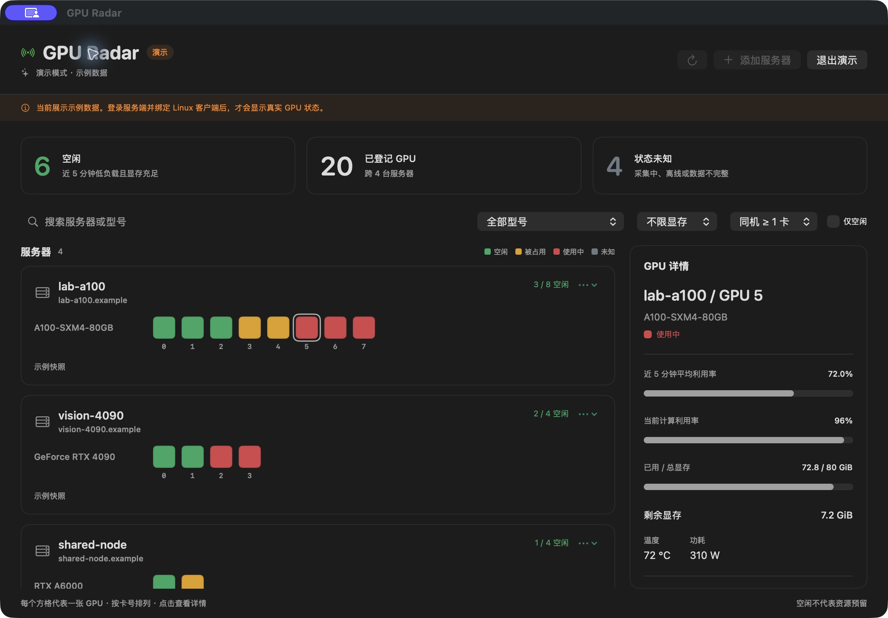

# GPU Radar

**简体中文** | [English](README.en.md)

在 Mac 菜单栏查看多台 Linux 服务器的 GPU 状态，快速找到可以使用的显卡。

GPU Radar 由 Linux 采集客户端、中心 API 和原生 macOS App 组成。每台服务器在菜单栏占一行：服务器名、显卡型号、每张 GPU 对应的颜色方格。方格不响应点击；利用率、显存和进程详情在桌面主窗口查看。

App 账户各自管理自己的服务器。**新账户注册需要邀请码，请向服务维护者私下获取。** 邀请码只用于创建新账户；已有账户登录、修改密码和安装 Agent 均不需要邀请码。服务器首次安装时登录 App 账户，之后使用独立设备凭据持续上报，不保存账户密码。

[下载安装包](https://github.com/Yuzhaoxin946/gpu-radar/releases/latest) · [完整 Linux 安装与维护指南](agent/README.md) · [验证范围](docs/validation.md)

## 界面预览

以下图片使用 1.0 版界面和内置演示数据，服务器、账户和进程均为示例。

### 菜单栏看板：扫一眼，找到空闲卡

每台服务器一行，依次显示服务器名、显卡型号和 GPU 方格。绿色为空闲，黄色为被占用，红色为使用中，灰色为数据不足或失效。面板随服务器数量增高，超过 10 行后滚动。



### 桌面主窗口：查看负载与显存详情

集中查看服务器状态，按型号、剩余显存和同机卡数筛选；点击 GPU 方格，在右侧查看近 5 分钟平均利用率、当前利用率、显存和进程信息。



## 从哪里开始

1. **Mac 上注册账户**：向服务维护者获取邀请码，打开 App，在桌面主窗口填写用户名、密码和邀请码后注册并登录。还没有 App 时，先[下载 macOS 1.0 安装包](https://github.com/Yuzhaoxin946/gpu-radar/releases/download/v1.0.0/GPU-Radar-1.0.0-macOS-arm64.dmg)。
2. **每台 GPU 服务器安装 Agent**：正常 SSH 登录服务器后，在交互式终端里运行下方安装命令；登录同一个 App 账户即可加入同一看板。
3. **回到 Mac 查看**：安装成功后每 5 秒更新一次。首次接入需要积累连续 5 分钟数据，期间 GPU 显示灰色。

## 安装 Linux 客户端

先在最新版 Mac App 中使用邀请码注册账户，然后以日常 SSH 用户登录 GPU 服务器，运行（已有账户直接安装即可）：

```bash
curl -fsSL https://github.com/Yuzhaoxin946/gpu-radar/releases/latest/download/install.sh | bash -s -- --username your_account
```

把 `your_account` 替换为 **App 账户名**。按提示输入 App 密码；密码不会回显，也不需要写进命令行。服务器名称默认取主机名，可追加 `--name lab-a`。

安装需要 Linux、Bash、curl、Python 3.6+、可正常运行的 `nvidia-smi`，以及到 GitHub 和服务端的 HTTPS 出站连接。普通用户和 root 都可以安装：安装器使用运行它的 Linux 账户主目录，按实际用户身份确定路径，不使用 `SUDO_USER` 或沿用的 `HOME`。root 直接执行或在管道右侧使用 `sudo bash` 时通常安装到 `/root`；`sudo -u other bash` 则安装到 `other` 的主目录。若需要 sudo，应放在 `bash` 一侧（`curl … | sudo bash -s -- …`），只给 `curl` 加 sudo 不会切换安装用户。

首次安装时，默认 `--background auto` 会选择可用的后台方式：普通用户使用用户级 systemd 和 linger；root 新安装优先使用系统级 systemd，不依赖 root 的 linger；已有用户级服务继续沿用。Docker 等没有可用 systemd 的环境会自动使用独立后台进程，不再因为无法配置开机启动而中止。安装器会：

- 下载并校验独立 Agent，无需 pip、Docker 或额外 Python 包。
- 检查真实 GPU 采集和 HTTPS 连接，再登录并绑定账户。
- 启动每 5 秒上报的后台采集，并验证首条数据被接受。
- systemd 模式检查服务 active/enabled；用户级服务还检查 linger。
- 每台主机独立保存配置与设备凭据，支持多台服务器共享 NFS 用户目录。
- 重复执行时保留本机已有绑定，不重复登记服务器；更新失败时尝试恢复原有安装。

**三种后台方式都可在退出 SSH 后继续采集。** systemd 模式会配置开机启动；独立进程模式会明确显示未配置重启恢复，**服务器或容器重启后需要手动启动，或接入容器的 entrypoint / 进程管理器**。首次安装可追加 `--background process` 明确使用独立进程，或 `--background systemd` 要求必须配置 systemd，失败时停止。重复安装保留原方式；更换方式需先按完整指南停止、卸载，不能直接用参数切换。首次接入需要连续积累 5 分钟数据，之后显示绿、黄、红状态。GPU 服务器无需新增入站端口。

只做预检，不登录、不安装后台服务：

```bash
curl -fsSL https://github.com/Yuzhaoxin946/gpu-radar/releases/latest/download/install.sh | bash -s -- --check
```

`--check` 检查下载、真实 GPU 采集和 HTTPS，不检查 systemd 或 linger 权限；这些在正式安装时检查。

GitHub 下载不可达时，可明确使用阿里云镜像：

```bash
curl -fsSL https://123.56.135.166/agent/install.sh | bash -s -- --mirror aliyun --username your_account
```

两种入口提供同一发行版本，并校验 Agent 的 SHA-256。镜像命令中的 `--mirror aliyun` 必须保留，这样 Agent 包也从镜像下载。镜像预检命令：

```bash
curl -fsSL https://123.56.135.166/agent/install.sh | bash -s -- --mirror aliyun --check
```

当前发行版 App 与安装器固定连接 `https://123.56.135.166`。安装时使用自己的 App 账户；服务器之间的 Linux 用户名可以不同。

首次绑定需要交互式 SSH 终端。部分跳板机的远程命令模式不会转发 TTY；请先正常登录目标 GPU 主机，再粘贴安装命令。在 Bash 自动化中，需要准确捕获管道下载失败时，先执行 `set -o pipefail`。

## 日常查看与维护

在目标 GPU 服务器上，以安装时的 Linux 用户管理采集。安装结果会说明使用用户级 systemd、系统级 systemd 或独立进程；root 的旧用户级安装仍按用户级方式维护。完整的状态、日志、启动、停止和卸载命令见 [Linux Agent 文档](agent/README.md#查看状态和管理后台服务)。

Docker / 独立进程模式可直接查看状态：

```bash
machine_id="$(cat /etc/machine-id)"
agent_file="$HOME/.local/share/gpu-radar/hosts/$machine_id/gpu-radar-agent.pyz"
agent_config="$HOME/.config/gpu-radar/hosts/$machine_id/agent.json"
python3 "$agent_file" background status --config "$agent_config"
tail -n 30 "$agent_config.background.log"
```

将 `status` 换成 `start` 或 `stop` 即可启动或停止。容器重启后保留了安装文件与配置时，执行 `start` 恢复采集；后台进程不会自行跨容器重启存活。

更新或重试时，重新执行原安装命令即可保留本机已有绑定及后台方式，不会重复登记服务器。`--username` 和 `--name` 不是改绑、改名选项；已有绑定与参数不一致时会停止。

共享 NFS Home 的主机必须各自拥有有效且唯一的 `/etc/machine-id`。程序、配置、锁和服务按主机隔离。旧版手动安装的 `gpu-radar-agent.service` 保持原样；安装器遇到旧版平铺配置或服务会停止，需核实所属主机后迁移。

停止采集、卸载、撤销设备凭据、详细路径和手动安装说明见 [Linux Agent 文档](agent/README.md)。

## 常见问题

| 现象 | 处理方式 |
| --- | --- |
| 邀请码无效或已用完 | 联系服务维护者获取有效邀请码；每成功创建一个新账户才消耗一个名额，安装 GPU Agent 不消耗名额 |
| 注册界面没有邀请码输入框 | 下载安装最新版 Mac App，或更新仓库并重新构建；旧版仍可登录已有账户 |
| GitHub 下载超时 | 使用阿里云镜像命令，并保留 `--mirror aliyun` |
| 提示需要交互式终端 | 先正常 SSH 登录目标 GPU 主机，再粘贴命令，尤其是经跳板机连接时 |
| Docker 没有 systemd / linger 不可用 | 首次安装默认自动退回独立进程，退出 SSH 后继续运行；重启恢复需手动启动或配置容器启动流程。只有 `--background systemd` 模式要求这些条件 |
| `Unsafe directory` | 核实错误中具体目录的属主和权限，仅针对确认归本人管理的目录修复；不要递归修改整个 Home 的权限，详见 Linux 指南 |
| 检测到 legacy 配置 | 保留旧配置和服务，先核实所属主机；不要复制设备凭据到其他服务器或直接删除配置来绕过检查 |
| GPU 一直显示灰色 | 首次等待连续 5 分钟；之后仍灰色时，查看采集日志、网络和最近上报情况 |
| 修改 App 密码后是否要重登 Agent？ | 不需要。设备继续使用独立凭据；旧 App 登录会话会失效 |

## 安装 macOS App

[下载 GPU Radar 1.0.0 DMG](https://github.com/Yuzhaoxin946/gpu-radar/releases/download/v1.0.0/GPU-Radar-1.0.0-macOS-arm64.dmg) · [发行说明及 SHA256SUMS](https://github.com/Yuzhaoxin946/gpu-radar/releases/tag/v1.0.0)

适用于 **Apple Silicon Mac（M 系列芯片）、macOS 13 或更新版本**，无需安装 Xcode、Swift 或源码。目前未提供 Intel 安装包。

1. 打开 DMG，将 `GPU Radar.app` 拖入 `Applications`。
2. 从“应用程序”打开 App，然后推出安装磁盘。
3. 使用已有账户登录，或使用邀请码注册。升级时先退出旧 App，再替换应用程序；可能需要重新登录，已绑定服务器不受影响。

此版本包含正式应用图标，使用 ad-hoc 临时签名，**尚无 Developer ID 签名和 Apple 公证**。macOS 可能阻止首次打开；确认下载来源后，可按 [Apple 官方说明](https://support.apple.com/en-ph/102445)在系统“隐私与安全性”中允许打开。无需关闭系统整体安全检查。DMG 不包含自动更新功能。

## 构建 macOS App

需要 macOS 13+、完整 Xcode 和 Swift 5.9+。在 **Mac** 上执行：

```bash
git clone https://github.com/Yuzhaoxin946/gpu-radar.git
cd gpu-radar
GPU_RADAR_BUILD_WORK="$PWD/.build/macos-build" ./macos/build-app.sh
open "macos/build/GPU Radar.app"
```

已经克隆仓库时，从项目根目录执行后两条命令即可。输出为 `macos/build/GPU Radar.app`。开发阶段直接运行这个编译产物；更新时先退出 App，再重新构建和打开，避免同时运行“应用程序”中的旧版。重新编译后可能需要重新登录。

App 提供邀请码注册、登录、修改密码和演示模式。修改密码会撤销旧的 App 登录会话，已绑定 GPU 服务器继续上报。菜单栏只做概览，桌面主窗口提供服务器和 GPU 详情。

主窗口的“添加服务器”直接提供当前账户的一键安装命令，可选择 GitHub 或阿里云镜像；安装过程中会提示输入账户密码，并完成后台启动。展开“单独登录命令”可查看已有客户端但尚未绑定时的命令，正常一键安装成功后无需重复登录。

菜单栏看板宽度为 420 点，每台服务器一行。高度随服务器数量增长，最多显示 10 行，超过后纵向滚动；单台服务器超过可见宽度的 GPU 方格可横向滚动，方格不响应点击。关闭主窗口后，菜单栏继续更新。

当前构建脚本使用临时签名，生成当前 Mac 架构的 App；尚未提供 Developer ID 签名或 Apple 公证。GitHub v1.0.0 Release 提供 Apple Silicon DMG、Linux 安装器、独立 Agent 和 SHA-256 校验文件。

### 打包为 DMG

维护者可以按上方步骤从源码构建；构建时自动生成并嵌入应用图标，然后执行：

```bash
./macos/package-dmg.sh
```

输出位于 `macos/build/GPU-Radar-<版本>-macOS-<架构>.dmg`。收到 DMG 的用户无需 Xcode、Swift 或源码：打开 DMG，将 `GPU Radar.app` 拖到其中的 `Applications` 文件夹，再从“应用程序”启动。需要 macOS 13 或更新版本，并选择与 Mac 处理器匹配的架构；`arm64` 用于 Apple Silicon。

打包脚本保留 App 原有签名，不会自动完成 Developer ID 签名或 Apple 公证。当前临时签名版本可能被 Gatekeeper 拦截，正式面向公众分发前应完成[签名与公证](https://developer.apple.com/macos/distribution/)。DMG 只负责安装，不提供自动更新；手动更新时先退出 App，再用新版替换“应用程序”中的旧版。

## 颜色含义

| 颜色 | 状态 | 判断条件 |
| --- | --- | --- |
| 绿色 | 空闲 | 最近 5 分钟平均利用率 <10%，且当前剩余显存 >90% |
| 黄色 | 被占用 | 最近 5 分钟平均利用率 <10%，且当前剩余显存 ≤90% |
| 红色 | 使用中 | 最近 5 分钟平均利用率 ≥10% |
| 灰色 | 数据不足或失效 | 窗口不足 5 分钟、指标不可用、采集失败或超过 30 秒未更新 |

平均值按服务端实际收样间隔加权，保存在数据库中。采样断档或利用率无效会重新积累窗口；无法读取的指标不会被当成零。进程信息只用于详情展示。

绿色表示监控结果，不是 GPU 预留。GPU Radar 不执行训练任务、不抢占显卡、不终止进程，也不提供作业调度。

## 项目结构

| 目录 | 内容 |
| --- | --- |
| `agent/` | Python 3.6+ 采集代码、安装器、独立包构建、systemd 模板 |
| `server/` | FastAPI、账户与设备认证、数据库和状态计算 |
| `macos/` | SwiftUI 桌面 App 与菜单栏界面 |
| `deploy/` | 原生 systemd / Nginx 和可选 Docker Compose 配置 |
| `scripts/` | 本地开发、测试与端到端联调脚本 |
| `docs/` | API 契约、部署指南和验证范围 |

## 本地开发与测试

后端开发需要 Python 3.11+。从项目根目录运行：

```bash
./scripts/setup-local.sh
./scripts/start-local.sh
```

本地 API 监听 `http://127.0.0.1:8000`，接口文档位于 `/docs`，数据库保存在 `.local/radar.db`。发布版 Mac App 使用固定云端地址；本地 API 可与 Agent CLI 联调。

```bash
.venv/bin/gpu-radar-agent --config .local/demo-agent.json login \
  --server http://127.0.0.1:8000 --name demo-lab --username researcher
.venv/bin/gpu-radar-agent --config .local/demo-agent.json run --simulate
```

请先按照 [服务端账户管理说明](server/README.md#invitation-only-registration)创建本地邀请码，再通过本地 API 注册测试账户；也可以用管理员命令直接创建测试账户。`--simulate` 会明确标记模拟数据；真实采集失败不会自动切换到模拟模式。

```bash
./scripts/test.sh
.venv/bin/python scripts/smoke.py
cd macos && swift test
```

更多说明：[API 契约](docs/api-contract.md) · [部署指南](docs/deployment.md) · [验证范围](docs/validation.md)。

项目主页和 Linux 安装指南均提供中英文版本；其余维护文档沿用各自现有语言。

当前聚焦个人账户与最新状态；尚未提供团队共享、长期历史、通知和完整 MIG 实例视图。
